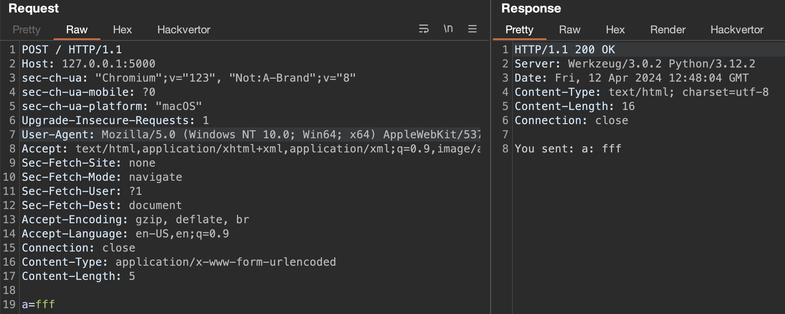

# Burp Repeater

Burp Repeater を使うと、HTTP リクエストを手動で操作・変更し、そのレスポンスを分析できます。Burp Intruder と同様に、Burp Repeater でバグを見つけるための決まった方法はなく、対象と、Web アプリケーションの脆弱性を見抜く操作者の腕しだいです。

## 使い方

先に進む前に、公式ドキュメントの
[Reissue request with Burp Repeater](https://portswigger.net/burp/documentation/desktop/getting-started/reissuing-http-requests)
の章に目を通してください。


**リクエストを送信するキーボードショートカットを設定する**

テストの流れをなめらかにするために、Burp Suite では、Burp Repeater でリクエストを送信するキーボードショートカットを設定できます。毎回 **Send** ボタンを手動でクリックする手間が減るので、テストが効率的になり、繰り返しの操作も少なくなります。[**Hotkey** の設定](https://portswigger.net/burp/documentation/desktop/settings/ui/hotkeys)で、**Issue Repeater request** に **Ctrl+R** を割り当てます。


## Burp Scanner にリクエストを送る

アプリケーションを操作するときは、リクエストを Burp Scanner に送る習慣をつけてください。リクエストをわずかに変えただけでも、Burp Scanner に送ると、バグを見つけられる可能性が高まります。

Burp Repeater から Burp Scanner にリクエストを送るには、次の手順に従います。

1. リクエストを右クリックします。
2. 表示されるコンテキストメニューで、**Scan** オプションを選びます。
3. **Audit coverage - maximum** を選ぶと、可能な限り網羅的なスキャンを行えます(詳細は、[組み込みの設定](https://portswigger.net/burp/documentation/scanner/scan-configurations/burp-scanner-built-in-configs)を参照)。
4. **OK** をクリックします。


開いているリクエストのアクティブスキャン用に、ホットキーを設定できます。ただし、Burp Scanner は、リクエストの監査に既定の設定を使います(手動でクリックしたときの **Audit coverage - maximum** の設定とは異なります)。[**Hotkey** の設定](https://portswigger.net/burp/documentation/desktop/settings/ui/hotkeys)で、**Do active scan** に割り当てます。


その後は、アクティブな Burp Scanner がリクエストを自動的に分析し、潜在的な脆弱性やセキュリティ上の問題を探ります。

Burp Scanner にリクエストを送るときは、背後のログも確認することを忘れないでください。詳しくは、[アプリケーションの処理が正しく動くことを確認する]({})のセクションを参照してください。

## 便利な拡張機能

Burp Repeater でリクエストを送るときは、次の拡張機能を使うことをお勧めします。

1. [Taborator](https://portswigger.net/bappstore/c9c37e424a744aa08866652f63ee9e0f) を使うと、Burp Repeater で `$collabplz` を使えるようになります。プレースホルダ `$collabplz` は、Burp Collaborator のペイロードに置き換えられます。Burp Collaborator が接続を検知したかどうかは、**Taborator** タブで分かります。
2. [Hackvertor](https://portswigger.net/bappstore/65033cbd2c344fbabe57ac060b5dd100) は、さまざまなエスケープやエンコードに対応した、タグベースの変換用拡張機能です。たとえば、Burp Repeater で入力を送るときに `<@base64>AAA<@/base64>` と書くだけで、Base64 でエンコードできて便利です。

## 自動スクロール

サーバー側のサニタイズを手動で回避しようとするときは、**Auto-scroll to match when text changes** を使い、ペイロードと検索フォームの両方に、任意のテキストを追加します。


`test1337` というプレースホルダを含むリクエストのペイロードの例



`test1337` というプレースホルダがレスポンスに現れたときに一致させる自動スクロールの設定


こうしておくと、特定のペイロードをいじっている間(たとえば、さまざまな特殊文字を試している間)、ペイロードがレスポンスに反映された位置まで、すぐにスクロールされます。

## レスポンスをブラウザで表示する

リクエストを編集して送信するときは、出力を実際のブラウザで見たくなることがあります(**Render** タブで HTTP レスポンスを表示するエンジンには限界があることを覚えておいてください)。また、望む結果を得るには、URL をコピーしてブラウザに貼り付けるだけでは、たいてい足りません。リクエストを、傍受したリクエストにコピーするのも便利ではありません。さらに、レスポンスが一度しか現れなかったり、再現しにくかったりすることもあります。

レスポンスをブラウザで表示するには、特定のレスポンスを右クリックして **Show response in browser** を選び、生成された URL を、Burp 経由のプロキシを通しているブラウザに貼り付けます。[公式ドキュメント](https://portswigger.net/burp/documentation/desktop/tools/message-editor#:~:text=Show%20response%20in%20browser)には、次のように書かれています。
> *このオプションを選ぶと、Burp は一意の URL を提示します。この URL を Burp のブラウザに貼り付けると、レスポンスが表示されます。ブラウザからのリクエストには、Burp が、選んだレスポンスそのものを返します(リクエストは元の Web サーバーには転送されません)。それでも、レスポンスは、元々リクエストした URL のコンテキストで、ブラウザによって処理されます。つまり、レスポンス内の相対リンクは、ブラウザによって正しく扱われます。その結果、ブラウザは、レスポンスを表示する過程で、たとえば画像や CSS のために、追加のリクエストを送ることがあります。これらは、通常どおり Burp が処理します。*

## CSRF の PoC を生成する

クロスサイトリクエストフォージェリ(CSRF)は、攻撃者が、ユーザーの同意や認識なしに、そのユーザーの代わりに操作を行わせることを可能にする、Web のセキュリティ上の脆弱性です。この攻撃は、サイトがユーザーのブラウザを信頼していることに依存し、パスワードなどが不正に変更される可能性があります。[CSRF 攻撃](https://portswigger.net/web-security/csrf)に習熟しておいてください。

CSRF の脆弱性があることを確認するために、Burp Suite には、CSRF 攻撃の概念実証(PoC)を自動生成する機能があります。Burp で CSRF 攻撃の PoC の HTML を自動生成するには、特定のリクエストを右クリックして、**Engagement tools** > **Generate CSRF PoC** を選びます。


CSRF の PoC を生成する Burp のコンテキストメニュー


Burp は、リクエストに合わせて、[攻撃手法](https://portswigger.net/burp/documentation/desktop/tools/engagement-tools/generate-csrf-poc#:~:text=Some%20points%20should%20be%20noted%20regarding%20CSRF%20techniques%3A)を自動的に調整しようとします。ただし、CSRF PoC ジェネレーターの **Options** ボタンをクリックして、手法を手動で選ぶ必要がある場合もあります。


設定可能な CSRF PoC のオプション


CSRF PoC の HTML が生成されたら、ファイルにコピーして、ブラウザで開けます。また、**Test in browser** ボタンを使うと、一意のリンクで PoC の HTML を手軽に開けます。この方法で、CSRF の脆弱性の影響を示せます。元のリクエストを実行したときと同じ操作を、生成した CSRF PoC で実行できれば、CSRF の脆弱性を見つけた可能性が高いです。

## Burp Repeater にも設定がある

Burp Repeater は設定も変更できます。特定のオプションは、次のようなより高度な攻撃で重要になります。

- [クライアント側のデシンク攻撃](https://portswigger.net/web-security/request-smuggling/browser/client-side-desync)  
- [HTTP リクエストスマグリング](https://portswigger.net/web-security/request-smuggling)

Burp Repeater の設定には 2 つのレベルがあります。1 つは、既定ですべての Burp Repeater タブに適用されるグローバルな設定(図 5)で、もう 1 つは、個々のタブごとのローカルな設定(図 6)です。ローカルな設定は、そのシナリオで別の設定が必要な場合に、グローバルな設定を上書きできます。


Burp Repeater の機能で設定可能なオプション



個々のタブ向けの Burp Repeater の設定


## Burp Repeater で便利な拡張機能

特定のリクエストを扱っているときに、特定の拡張機能を実行できます。リクエストを右クリックして **Extensions** を選び、次のような特定の拡張機能を選びます。

- [Param Miner](https://portswigger.net/bappstore/17d2949a985c4b7ca092728dba871943)(**guess everything** オプション)は、隠れたパラメータやヘッダーを見つけるためのもので、隠れた機能を明らかにすることがあります。
- [HTTP Request Smuggler](https://portswigger.net/bappstore/aaaa60ef945341e8a450217a54a11646)(**Launch all scans** オプション)は、[HTTP リクエストスマグリング](https://portswigger.net/research/http-desync-attacks)攻撃を仕掛けます。
- [403 Bypasser](https://portswigger.net/bappstore/444407b96d9c4de0adb7aed89e826122) は、リクエストの組み合わせを変えながら送り、認可の問題を見つけます。
- [Server-Side Prototype Pollution Scanner](https://portswigger.net/bappstore/c1d4bd60626d4178a54d36ee802cf7e8) は、Node アプリケーションの[サーバー側のプロトタイプ汚染](https://portswigger.net/blog/server-side-prototype-pollution-scanner)の問題を見つけようとします。

**Logger** タブでは、これらの拡張機能がどう動くか(つまり、サーバーに送られたリクエスト)を観察できます。

## Burp Repeater のさまざまなヒント

### 印字できない文字

Burp Repeater は、印字できない文字を表示できます。これは、特定の問題を突く場合(たとえば WAF の回避)に役立ちます。**\n** ボタンで有効にできます。

次に示すのは、Hackvertor 拡張機能を使って印字できない文字を送る HTTP リクエストの例と、それらを印字できる形で表示するレスポンスです。


Burp で、印字できない文字を含むレスポンスの例


### リクエストの最小化

HTTP リクエストを最小化するには、[Request Minimizer](https://portswigger.net/bappstore/cc16f37549ff416b990d4312490f5fd1) を使います。この拡張機能は、不要なヘッダーやパラメータを取り除きます。項目を 1 つ取り除くたびに、拡張機能がリクエストを再送し、レスポンスが元のリクエストのものと一致することを確かめます。


**Request Minimizer** のコンテキストメニュー



元の HTTP リクエストと、最小化したリクエストの比較



監査レポートに HTTP リクエストを載せる前に、この拡張機能で最小化しましょう。レポートが読みやすくなります。


### Content Type Converter を使う

Content Type Converter 拡張機能を使うと、リクエストで送信するデータを、次のように変換できます。

- JSON から XML
- XML から JSON
- ボディパラメータから JSON
- ボディパラメータから XML

例: 元のリクエストが JSON でデータを送信しているなら、データを XML に変換して、アプリケーションが XML 形式のデータを受け付けるかどうかを確かめます。受け付ける場合は、XML に関連する脆弱性(XXE など)を探します。


Content Type Converter のコンテキストメニュー

