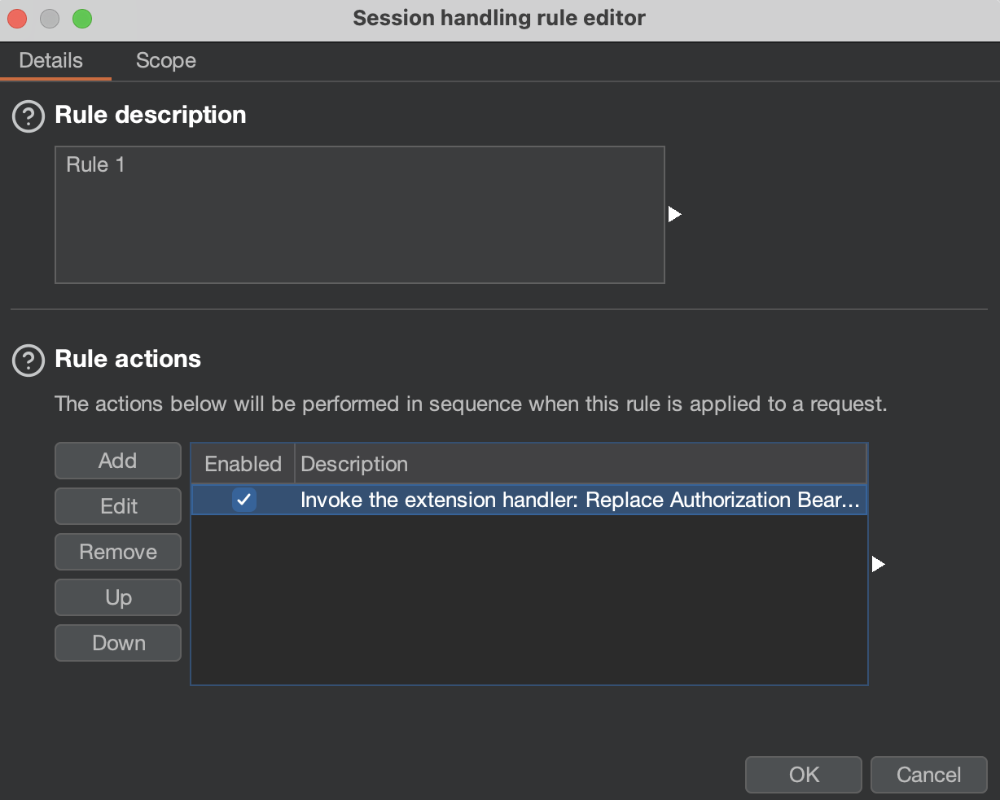

# Burp のそのほかのベストプラクティスとヒント

## Burp Suite 全体から特定の文字列を探す

ある値やエラーの文字列を探したいのに、どこで見たか（どの Burp のツールだったか）思い出せないとします。
Burp Repeater だったか、Burp Scanner だったか、Burp Target だったか。見つけるには、Burp Suite のグローバル検索を使います（**Burp** > **Search** から開けます）。


Burp Suite の **Search** 機能を呼び出すコンテキストメニュー



Burp のグローバルな **Search** 機能


## 競合状態の問題のテスト

競合状態（レースコンディション）は、イベントのタイミングや順序が、システムの動作に影響するときに起こります。ウェブアプリケーションでは、
アプリケーションのセキュリティ上の判断が、処理されるリクエストの順序やタイミングに依存している場合に、競合状態が起こりえます。
競合状態の問題については、[PortSwigger のウェブサイト](https://portswigger.net/web-security/race-conditions)で詳しく学べます。

### Burp Repeater で競合状態をテストする

競合状態を手軽に検出できるよう、Burp では複数のリクエストをグループにして、短い時間枠の中で送信できます。
そのため、Burp Repeater で複数のリクエストを用意して、ほぼ同時に送り、システムの動作を観察できます。

Burp Repeater で複数のリクエストをグループにするには、**+** をクリックして **Add tab** を選びます。


**Repeater** タブでのタブの追加


次に **Create new group** をクリックして、グループにするタブ（あらかじめ用意したリクエスト）を選びます。


Burp Repeater のタブの新しいグループの作成


次に **Send group (parallel)** を選びます。


Burp Repeater のグループ送信のオプション


Burp は、リクエストの HTTP バージョンに応じて、次の手法でグループのすべてのリクエストを送信します。

- HTTP/1 の場合 — last-byte technique
- HTTP/2 の場合 — single-packet attack

個々の攻撃タイプの詳しい情報は、元の研究、
[Smashing the state machine: the true potential of web race conditions](https://portswigger.net/research/smashing-the-state-machine) にあります。

### Turbo Intruder で競合状態をテストする

Turbo Intruder でも、リクエストの複数のインスタンスを並列に送信できます。Burp で（Burp Repeater などから）特定の
リクエストを選び、右クリックして **Extensions** > **Turbo Intruder** > **Send to Turbo Intruder** を選びます。次に、サンプルのスクリプト **`examples/race-single-packet-attack.py`** を選びます。


Turbo Intruder のサンプルスクリプト `race-single-packet-attack.py`


続いて、選んだスクリプトのコメントに従って、エンジン（8 行目）を 14 行目のキューに入れるリクエストの数に合わせて調整し、
**Attack** をクリックして、結果を観察します。

リクエストの特定のパラメータを区別する必要があるときは、次のようにできます。

1. リクエストで Hackvertor のタグを使う。

Turbo Intruder のリクエストでの Hackvertor のタグの使用例


2. `%s` の注入ポイント（たとえば `for` ループのイテレータ `i`）を使う。注入ポイントを設定するには、リクエストに `%s` のプレースホルダを置き、
    エンジンのキューを編集して、次のようにイテレータ `i` を含めます。

    ```py
    engine.queue(target.req, str(i), gate=’race1’):
    ```


Turbo Intruder の注入ポイントの設定例


こうすると、`%s` を置いた場所はどこでも、リクエストの中で繰り返しの番号に置き換えられます。

### Backslash Powered Scanner で競合状態の可能性を自動で見つける

ターゲットの競合状態の可能性を自動で探るには、Backslash Powered Scanner を有効にして、
アクティブスキャンを実行する必要があります。

拡張機能が **Issues** タブに挙げた問題の例を次に示します。


Backslash Powered Scanner 拡張機能が挙げた、競合状態の問題の例


## アクセス制御の問題のテスト


アクセス制御の問題については、[Access control vulnerabilities and privilege escalation](https://portswigger.net/web-security/access-control) で学べます。


ウェブアプリケーションのアクセス制御は、通常、[ユーザーのロール](https://en.wikipedia.org/wiki/Role-based_access_control)で定義されます。
たとえば、一般のエンドユーザーのアカウントと、
管理者のアカウントがあるかもしれません。それぞれのロールは、アプリケーション内で異なるアクセス権を持つことがあります。この場合、各ロールは、認可用のクッキーやヘッダーに基づいて、サーバー側で検証されるべきです。
[Autorize](https://portswigger.net/bappstore/f9bbac8c4acf4aefa4d7dc92a991af2f) 拡張機能は、ウェブアプリケーションのアクセス制御のテストを、
柔軟かつ効率的に行うために作られています。

Autorize の一般的な使い方は、アプリケーションの別のロールの認可用のクッキーやヘッダーを拡張機能に追加し、
必要に応じて検出器を設定してから、アプリケーションを操作することです。アプリケーションを操作すると、リクエストの一部（ヘッダーやクッキーなど）を
変更したうえで再送信されます。つまり、想定されているのとは別のユーザーロールを偽装していることになります。
Autorize は、傍受したリクエストを、このように置き換えたセッション識別子で自動的に変更して再送信します。
これにより、サーバーが受信した各リクエストを適切に認可しているかを調べられ、一般ユーザーが管理機能にアクセスできるといった
アクセス制御の食い違いが明らかになります。また、特定のヘッダーやクッキーなしでリクエストを送る、未認証の視点を確認することもできます。

Autorize の表には、リクエストの URL と強制の状態が表示されます。


結果の表を含む、Autorize の設定例


Autorize 拡張機能を使うときの役に立つヒントは次のとおりです。

- **Check Unauthenticated** の機能を使うのを忘れないこと。
- インターセプトのフィルタを設定して、Autorize に送られるリクエストの元を絞り込む。たとえば、スコープ内の項目だけを含め、
`OPTIONS` リクエストや、認可のテストの観点では不要なそのほかのリクエストを無視する。
- バグを見逃さないよう、**Enforcement Detector** と **Detector Unauthenticated** の機能を、必ず状況に合わせて調整する。
- 結果を慎重に見直す。注意点に気をつける。たとえば、リクエストのパラメータには一意でなければならないものがあり、その一意性のためにアプリケーションがエラーを返すことがあるので、
Autorize が認可の問題を正しく分析できません。この問題を解決するには、
Autorize に送る元のリクエストで Hackvertor 拡張機能を使います。Autorize がそのタグを処理します。
Burp Proxy で Hackvertor のタグを使うには、設定で **Allow tags in Proxy** を選んで有効にします。


Burp の Hackvertor 拡張機能で設定できる項目


参考資料:

- [Autorize](https://github.com/PortSwigger/autorize): 認可の強制を自動で検出する拡張機能
- [Finding “BAC - IDOR -PE” Within a Minute using Autorize Tool](https://medium.com/@Cyber_siva/finding-bac-idor-pe-within-a-minute-using-autorize-tool-5aad4f0b563f)
- [Burp Suite tutorial: IDOR vulnerability automation using Autorize and AutoRepeater (bug bounty)](https://www.youtube.com/watch?v=3K1-a7dnA60)

Autorize 拡張機能がターゲットに合わない場合は、[AutoRepeater](https://portswigger.net/bappstore/f89f2837c22c4ab4b772f31522647ed8)
拡張機能を試してください。リクエストを自動で複製、変更、再送信できます。条件付きの置換のオプションも多くあります。
詳しくは、次の資料を参照してください。

- [Burp Repeater - whether user permissions are working properly](https://security-szurek-pl.translate.goog/burp-autorepeater-czy-uprawnienia-dzialaja-prawidlowo/?_x_tr_sl=en&_x_tr_tl=pl&_x_tr_hl=en&_x_tr_pto=wapp)
- [BSides Rochester 2018 - AutoRepeater: Automated HTTP Request Repeating With Burp Suite](https://www.youtube.com/watch?v=IYFLp_4ccrw)
- [AutoRepeater: Automated HTTP Request Repeating With Burp Suite](https://github.com/nccgroup/AutoRepeater)

## Collaborator Everywhere を実行する

Collaborator Everywhere 拡張機能は、Burp Collaborator へのピングバックを引き起こすことでバックエンドのシステムを明らかにする、
侵襲的でないヘッダーを追加します。また、ウェブアプリケーションが、ユーザーが制御できるヘッダーに基づいて実際の IP アドレスの可能性があるものを返す場合に、
IP アドレスの偽装の可能性を検出することもできます。ただし、追加されたヘッダーが、ウェブアプリケーションの通常の機能を妨げることがあります。
そのため、拡張機能を常に有効にしておく必要はありませんが、アプリケーションのあらゆる隅で、少なくとも 1 回は試すことをお勧めします。

Collaborator Everywhere 拡張機能は、スコープ内のプロキシのトラフィックの `User-Agent` ヘッダーに、適切なヘッダーとペイロードを追加します。


Collaborator Everywhere 拡張機能が処理したリクエストの例


Collaborator Everywhere が挙げたエクスプロイトの問題の詳細は、[Cracking the lens: targeting HTTP's hidden attack-surface](https://portswigger.net/research/cracking-the-lens-targeting-https-hidden-attack-surface) を参照してください。

## レスポンスも傍受して変更できる

Burp では、通常はリクエストを傍受して変更し、特定の結果を得ますが、HTTP レスポンスを傍受することにも、
次のような利点があります。

1. モバイルアプリケーションでコンテンツがどう表示されるかを分析する
2. 特定のレスポンスヘッダー（`Content-Security-Policy` など）を削除・変更する
3. レスポンスを変更する。

    a. [**隠しフォームフィールドを表示する**](https://portswigger.net/support/using-burp-to-bypass-hidden-form-fields)

    b. **無効なフォームフィールドを有効にする**

    c. **入力フィールドの長さの制限を取り除く**

たとえば、レスポンスから `Content-Security-Policy` ヘッダーを削除するには、**Match and replace rules** の見出しの下で、
**Add** を選びます。


リクエストとレスポンスの変更ができる、Burp の Proxy の設定



レスポンスのヘッダーから CSP ヘッダーを削除する、一致と置換のルールの例


すると、HTTP history の **Edited** にチェックが付きます。

リクエストを選んだあと、**Auto-modified response** を選ぶと、Burp が CSP ヘッダーを削除したことが分かります。


自動で変更されたレスポンスの表示


資料:

- [Using Burp Suite match and replace settings to escalate your user privileges and find hidden features](https://www.jonbottarini.com/2019/06/17/using-burp-suite-match-and-replace-settings-to-escalate-your-user-privileges-and-find-hidden-features/)

## すべてのタスクを止める

Burp のすべてのタスク（アクティブな Burp Scanner、Burp Intruder など）を止めたいときは、通常、次の電源ボタンを使えます。


Burp のダッシュボードですべてのタスクを一時停止する


このボタンは、すべてのタスクを一時停止しますが、実行中の拡張機能は止めません。そのため、リクエストを発行している拡張機能が動いていれば、
リクエストは送られ続けます。たとえば、Param Miner 拡張機能を使っているとき、タスクの実行を
一時停止しても、Logger ではリクエストが送られ続けているのが分かります。

赤い非常ブレーキを引きたい（つまり、すべてのトラフィックを止めたい）場合は、[Distribute Damage](https://portswigger.net/bappstore/543ab7a08d954390bd1a5f4253d3763b)
拡張機能を使い、**pause all traffic** を選びます。


すべてのトラフィックを止める、Distribute Damage 拡張機能の設定


## BChecks

Burp に標準で備わっている、パッシブとアクティブのスキャンチェックのライブラリは豊富です。また、利用できるすべての拡張機能によって、ライブラリは大きく広がります。
それでも、組織に合わせたカスタムのチェックがほしい場合や、
Burp がカバーしていない特定のバグを探したい場合はどうでしょうか。簡単な解決策が BChecks です。

### BChecks とは

公式のドキュメントには、次のように書かれています。

> *BChecks は、作成してインポートできるカスタムのスキャンチェックです。Burp Scanner は、組み込みのスキャン処理に加えて、これらのチェックを実行します。スキャンの対象を絞り、テストの作業を可能な限り効率的にするのに役立ちます。*

BChecks は、拡張子 `.bcheck` のファイルに、チェックの動作を宣言するための、プレーンテキストの独自の定義言語で書きます。
詳しくは、[BCheck の例](https://github.com/PortSwigger/BChecks)を参照してください。

例として、[`suspicious-input-transformation.bcheck`](https://github.com/PortSwigger/BChecks/blob/main/examples/suspicious-input-transformation.bcheck) を見てみましょう。
この BCheck ファイルをよく見ると、このチェックは、アプリケーションに、サーバーサイドのテンプレートインジェクションのような、
サーバーサイドのコードインジェクションの脆弱性があることを示唆する、不審な入力の変換を特定するためのものだと分かります。

`suspicious-input-transformation.bcheck` の中身は次のとおりです。

1. **metadata:** このセクションは、BCheck の基本的な情報を示します。

2. **define:** このセクションは、2 つの変数を定義します。calculation 変数には、数式の文字列表現（`1337*1337`）が設定され、
answer 変数には、その計算結果（`1787569`）が設定されます。

3. **given insertion point then:** ここから BCheck の主なロジックが始まります。

4. **report issue:** このセクションは、報告される問題（重大度、確信度、詳細、対処方法）を記述します。



```yaml
metadata:
    language: v1-beta
    name: "Insertion-point-level"
    description: "Inserts a calculation into each parameter to detect suspicious input transformation"
    author: "Carlos Montoya"

define:
    calculation = "{{1337*1337}}"
    answer = "1787569"

# we will automatically insert into nested insertion points
given insertion point then
    # prevent false positives by checking answer isn't
    # already in base response
    if not({answer} in {base.response}) then
        send payload:
            appending: {calculation}

        if {answer} in {latest.response} then
            report issue:
                severity: high
                confidence: tentative
                detail: "The application transforms input in a way that suggests it might be
                         vulnerable to some kind of server-side code injection."
                remediation: "Manual investigation is advised."
        end if
    end if
```



### なぜ BChecks か

カスタムのチェックを追加する拡張機能を自作するのも選択肢ですが、簡単な作業ではありません。プログラミングの時間と専門知識が、かなり必要です。
一方、BChecks は、もっと簡単な解決策です。大がかりなコーディングなしに、
パッシブとアクティブの探索を自動化できます。

たとえば、[正規表現で検索を自動化](https://karol-mazurek.medium.com/appsec-tales-xxii-ldapi-fcef1f40e9b2#:~:text=You%20can%20automate%20the%20search%20with%20the%20regex%20using%20BChecks)して、
LDAP が使われていることを明かす情報がないかを調べられます。アプリケーションの情報漏えいの可能性を探すときに、とくに役立ちます。
BChecks なら、このチェックを 1 回設定すれば、今後のすべてのスキャンで自動的に実行できます。

### BChecks のコレクション

BChecks でできることのほかの例は、Burp Suite Professional 向けの[公式の BChecks コレクション](https://github.com/PortSwigger/BChecks)を見てください。
自分のチェックを作るときの、よい出発点になります。例から学び、必要に応じて変更できます。
and modify them to suit your needs.

### 組織のための BChecks

BChecks は個人のものだけでなく、組織全体にも適用できます。BChecks（`*.bcheck` ファイルの形式）をチームのメンバーに配布すれば、
全員が同じバグを探せるようになります。

## Bambdas で HTTP history を絞り込む

Bambda モードを使うと、短い Java のスニペットで、Burp のツールをカスタマイズできます。たとえば、次の [Bambda](https://github.com/PortSwigger/bambdas/blob/abeaea2a0ae02916fa2191ac4c6a41d775e83c08/Filter/Proxy/HTTP/FindJSONresponsesWithIncorrectContentType.bambda) を使うと、
HTTP history から、`Content-Type` が誤っている JSON のレスポンスを見つけられます。


HTTP history での Bambda の例


そのほかの Bambda は、[GitHub の Bambdas コレクション](https://github.com/PortSwigger/bambdas)にあります。
また、ドキュメント [Filtering the HTTP history with Bambdas](https://portswigger.net/burp/documentation/desktop/tools/proxy/http-history/bambdas) も読んでください。

## Hackvertor のカスタムタグ

Hackvertor 拡張機能では、Python または JavaScript に基づく独自のタグを設定できます。

次の使用例を見てください。
<!-- markdownlint-disable no-inline-html line-length -->

<center><blockquote class="twitter-tweet" data-dnt="true"><p lang="en" dir="ltr">If you&#39;re testing a site that needs a unique CSRF-token for each call, you can use Hackvertor&#39;s custom tags to make a simple python script to fetch a new token for you. Very simple solution and works very nicely. Thank you again <a href="https://twitter.com/garethheyes?ref_src=twsrc%5Etfw">@garethheyes</a>!<a href="https://t.co/nd2cxTPQiL">https://t.co/nd2cxTPQiL</a> <a href="https://t.co/Vlp1Anxeqk">pic.twitter.com/Vlp1Anxeqk</a></p>&mdash; Frans Rosén (@fransrosen) <a href="https://twitter.com/fransrosen/status/1361594153268871168?ref_src=twsrc%5Etfw">February 16, 2021</a></blockquote> <script async src="https://platform.twitter.com/widgets.js" charset="utf-8"></script></center>

<!-- markdownlint-restore -->
公式の Hackvertor のタグストアも見てみましょう。


Burp の上部のメニューバーから開ける、Hackvertor のタグストア


## Easy Auto Refresh の Chrome 拡張機能を Burp で活用する

[Easy Auto Refresh](https://chromewebstore.google.com/detail/easy-auto-refresh/aabcgdmkeabbnleenpncegpcngjpnjkc)
の Chrome 拡張機能を Burp と組み合わせると、セッションを延ばして自動ログアウトを防ぐ、最も簡単な方法になります。拡張機能に適切な
リフレッシュ時間を設定して、Burp 経由でトラフィックをプロキシするだけです。サイトはログイン状態を保つはずです。クッキーが変わっても、
Burp のクッキージャーが、Burp Scanner が発行する適切なリクエストのクッキーを自動で更新します。


Chrome ブラウザの Easy Auto Refresh のポップアップ


ターゲットのサイトでリフレッシュの操作を行うと、認証のフロー全体が自動で実行されて、ターゲットが必要とする
新しい `Authorization: Bearer` トークンが得られる場合は、Authorization Bearer Detector and Replacer の
カスタム拡張機能をインストールできます（図 22）。これにより、認可ヘッダーの期限が切れて、Burp が送るリクエストが
「401 Unauthorized」エラーを返す状況を避けられます。この拡張機能は、ブラウザがプロキシしたトラフィックから認可ヘッダーを読み取り、
Burp が送るリクエストで古いヘッダーの期限が切れたときに、それを置き換えます。

これを動かすには、拡張機能をインストールし（図 23）、ターゲットのホスト名（19 行目）を編集して、Burp Scanner と Burp の拡張機能で
カスタム拡張機能を有効にするための、新しいセッション処理ルールを追加します。Burp の設定で **Sessions** タブに移動し、
新しいセッション処理ルールを追加します。**Rule actions** で **Add** と **Invoke a Burp extension** を選び、次に、
拡張機能のアクションハンドラで **Replace Authorization Bearer Token** を選びます。**Session handling rule editor** ウィンドウで、
**Scope** タブに移動し、**Tools scope** で **Scanner** と **Extensions** を選びます。



セッション処理ルールの設定




```python {linenos=inline}
from burp import IBurpExtender, IProxyListener, IHttpRequestResponse, IExtensionHelpers, ISessionHandlingAction, IRequestInfo
from java.util import ArrayList
from java.net import URL

class BurpExtender(IBurpExtender, IProxyListener, ISessionHandlingAction):
    def registerExtenderCallbacks(self, callbacks):
        self._callbacks = callbacks
        self._helpers = callbacks.getHelpers()
        callbacks.setExtensionName("Authorization Bearer Detector and Replacer")
        callbacks.registerProxyListener(self)
        callbacks.registerSessionHandlingAction(self)
        self.previous_token = None
        print("Authorization Bearer Detector and Replacer extension loaded.")

    def processProxyMessage(self, messageIsRequest, message):
        if messageIsRequest:
            http_service = message.getMessageInfo().getHttpService()
            url = URL(http_service.getProtocol(), http_service.getHost(), http_service.getPort(), "")
            if url.toString().startswith("https://XX.com"):
                request = message.getMessageInfo().getRequest()
                headers = self._helpers.analyzeRequest(request).getHeaders()
                for header in headers:
                    if header.startswith("Authorization: Bearer"):
                        token = header.split(" ")[2]
                        if self.previous_token != token:
                            print("New Authorization Bearer found in a request to " + url.toString() + ": " + token)
                            self.previous_token = token
                            self.replaceToken(message.getMessageInfo())

    def replaceToken(self, messageInfo):
        request = messageInfo.getRequest()
        requestInfo = self._helpers.analyzeRequest(request)
        headers = requestInfo.getHeaders()
        newHeaders = []
        for header in headers:
            if header.startswith("Authorization: Bearer"):
                newHeader = "Authorization: Bearer " + self.previous_token
                newHeaders.append(newHeader)
            else:
                newHeaders.append(header)
        newRequest = self._helpers.buildHttpMessage(newHeaders, request[requestInfo.getBodyOffset():])
        messageInfo.setRequest(newRequest)

    def getActionName(self):
        return "Replace Authorization Bearer Token"

    def performAction(self, currentRequest, macroItems):
        self.replaceToken(currentRequest)
        return None
```



## Burp Suite でアップストリームプロキシを設定する

### プロキシのチェーン

ウェブアプリケーションによっては、トラフィックを、あらかじめ決められたプロキシ経由にする必要があります。その場合、接続先のウェブサーバー用に、ブラウザにあらかじめ決められたプロキシを設定すると、
Burp Suite でトラフィックを傍受できなくなります。この問題を解決するために、Burp Suite ではアップストリームプロキシを設定できます。
Burp でトラフィックを傍受し、ウェブアプリケーションへのアクセスに使うプロキシに転送できます。

アップストリームプロキシは、複数のウェブアプリケーションのテストツールを使うときにも役立ちます。たとえば、Burp Suite は、
[Zed Attack Proxy（ZAP）](https://www.zaproxy.org/) や、[mitmproxy](https://mitmproxy.org/) をもとにしたカスタムの自動化スクリプトとチェーンできます。
プロキシをチェーンすると、テスト中に、それぞれのツールの強みを同時に活かせます。

### Burp Suite での設定

アップストリームプロキシを設定するには、**Settings** > **Network** > **Connections** に移動し、
**Upstream proxy servers** のセクションまでスクロールします。**Add** をクリックして、新しいアップストリームプロキシを設定します。ポップアップのウィンドウで、接続先の
ホスト、プロキシのホストまたは IP アドレス、プロキシのポートを指定します。プロキシが認証を必要とする場合は、認証の種類、ユーザー名、パスワードなど、
認証に関する情報もさらに指定します。

### Burp を ZAP 経由でプロキシする

次の例では、Burp を ZAP 経由でプロキシします。Burp は `localhost:8080` で待ち受け、ZAP は `localhost:8081` で待ち受けます。
Burp には、ZAP をアップストリームプロキシとして設定します。次の設定では、すべてのホストへのトラフィックが ZAP にプロキシされます。


アップストリームプロキシのルールの設定例


Burp Suite の組み込みブラウザで `trailofbits.com` を開くと、次のように表示されます。


Burp の組み込みブラウザ。ZAP 経由でもプロキシされているウェブサイトが表示され、ZAP の HUD がサイトに追加されている


ブラウザの端に新しい要素があることに注目してください。ZAP は、ヘッドアップディスプレイ（HUD）を提供するために、これらの要素をページに挿入します。
Burp Suite の HTTP history を見ると、`trailofbits.com` への対応するリクエストも見つかります。

## Docker のトラフィックを Burp Suite 経由でプロキシする

Docker のトラフィックを Burp Suite 経由でプロキシするのは、難しいことがあります。Docker のアプリケーションは通常、隔離されたコンテナのネットワークで動いていて、Burp はホストで動いているからです。このセクションでは、Docker コンテナのトラフィックを、ホストマシンで動いている Burp 経由でプロキシする方法を説明します。

まず、Docker の環境についての注意です。このセクションは、[Docker for Mac](https://docs.docker.com/desktop/install/mac-install/) または [Docker for Windows](https://docs.docker.com/desktop/install/windows-install/) を使っていて、したがって [`host.docker.internal`](https://docs.docker.com/desktop/networking/#i-want-to-connect-from-a-container-to-a-service-on-the-host) にデフォルトでアクセスできることを前提にしています。Linux 環境で Docker を動かしている場合は、`--net=host` と `localhost` を使うか、デフォルトの `bridge` ネットワークで `172.17.0.1` を使えます。詳しくは、StackOverflow のこの質問を見てください: [What is the Linux equivalent of "host.docker.internal"?](https://stackoverflow.com/questions/48546124/what-is-the-linux-equivalent-of-host-docker-internal)。それを踏まえて、このセクションの残りでは `host.docker.internal` を使います。

Docker コンテナのトラフィックを Burp 経由でプロキシするには、Burp の CA 証明書をエクスポートする必要があります。[ドキュメント](https://portswigger.net/burp/documentation/desktop/tools/proxy/manage-certificates#exporting-and-importing-the-ca-certificate)に、その方法の優れた手引きがあります。Burp の CA 証明書を `~/Downloads/burp.pkcs12` にエクスポートしたものとします。証明書と秘密鍵のペアをエクスポートすると、Burp は PKCS#12 形式を使います。ほとんどのアプリケーションは、PEM 形式の CA バンドルを期待します。PKCS#12 の CA バンドルを PEM 形式に変換しましょう。

```bash
openssl pkcs12 -in ~/Downloads/burp.pkcs12 -nodes -out ~/Downloads/burp.pem
```

次に、PEM 形式の CA バンドルと `curl` を使って、Burp のプロキシをテストできます。次のコマンドを実行して、Burp Proxy タブの HTTP history タブでリクエストを確認します。

```bash
docker run \
    --volume ~/Downloads/burp.pem:/tmp/burp.pem \
    curlimages/curl:latest \
    --proxy host.docker.internal:8080 \
    --cacert /tmp/burp.pem \
    https://www.google.com
```

`host.docker.internal` は、ホストマシンを参照するための Docker Desktop の特別なドメインで、`8080` は Burp のデフォルトのプロキシのリスナーのポートです。ここでは、基本的な `curl` の Docker イメージのトラフィックを、Burp 経由でプロキシする方法を示しました。もう 1 つ、よく出会う場面が Go のアプリケーションです。その例を試してみましょう。

HTTP リクエストをテストするために、`req.go` という名前の次の Go コードを使います。

```go
package main

import (
    "io/ioutil"
    "log"
    "net/http"
)

func main() {
    resp, err := http.Get("https://www.google.com")
    if err != nil {
        log.Fatalln("Unable to get response from server:", err)
    }
    defer resp.Body.Close()

    body, err := ioutil.ReadAll(resp.Body)
    if err != nil {
        log.Fatalln("Unable to read response body:", err)
    }

    log.Println("Response from Google:", string(body))
}
```

次のコマンドでスクリプトを実行します。

```bash
docker run \
    --volume $(pwd)/req.go:/go/req.go \
    golang:latest go run req.go
```

次のコマンドを実行すると、HTTPS の検証エラーになるはずです。

```bash
docker run \
    --env HTTPS_PROXY=host.docker.internal:8080 \
    --volume $(pwd)/req.go:/go/req.go \
    golang:latest go run req.go
2024/06/24 14:06:02 Unable to get response from server: Get "https://www.google.com": tls: failed to verify certificate: x509: certificate signed by unknown authority
exit status 1
```

上と同じように Burp の CA バンドルを渡すと、エラーを直せます。

```bash
docker run \
    --env SSL_CERT_DIR=/usr/local/share/ca-certificates \
    --volume ~/Downloads/burp.pem:/usr/local/share/ca-certificates/burp.pem \
    --env HTTPS_PROXY=host.docker.internal:8080 \
    --volume $(pwd)/req.go:/go/req.go \
    golang:latest go run req.go
```

これは、[`crypto/x509`](https://pkg.go.dev/crypto/x509#SystemCertPool) が提供する環境変数 `SSL_CERT_DIR` を使って、カスタムの CA バンドルを指定しています。これで、Burp の HTTP history タブに、`User-Agent: Go-http-client/2.0` のようなヘッダーを持つリクエストが表示されるはずです。なお、`HTTP(S)_PROXY` で Go のバイナリのリクエストをプロキシする場合、リクエストのホストが `localhost` だと、[プロキシは働きません](https://pkg.go.dev/net/http#ProxyFromEnvironment)。最も簡単な対処は、`/etc/hosts` で[別のホスト名を設定](https://stackoverflow.com/a/69794246)して、そちらを使うことです。

ほかのプログラミング言語やアプリケーションのランタイムをプロキシするには、別の環境設定が必要なことがあります。たとえば、Python の `requests` ライブラリの環境変数 [`REQUESTS_CA_BUNDLE`](https://requests.readthedocs.io/en/latest/user/advanced/#ssl-cert-verification) です。Docker アプリケーションの技術スタックを調べて、そのトラフィックを Burp 経由でプロキシする方法を理解してください。
